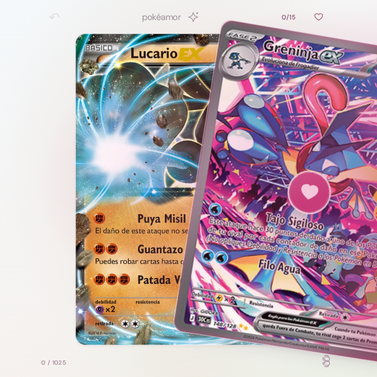

# pokéamor 💘

A mobile-first Pokémon card-collection microsite. Swipe through the catalog, build
your team of six, and let the app learn what you love. Everything runs in a single
[Cloudflare Worker](https://developers.cloudflare.com/workers/) — no framework, no
dependencies.

The UI is in Spanish ("¿me gusta o paso?"), the source is small and readable, and the
whole experience is driven by a light recommendation engine that adapts to your choices.

---

## What you can do

- **Swipe** cards (❤️ me gusta / ✕ paso) with haptic, sound, and motion feedback.
- **Collect** Pokémon into *tandas* (batches of 15) and browse your full album.
- **Build a team** of six protagonists and refine it with head-to-head **duels**.
- **Get recommendations** — a Bradley–Terry model + an online logistic worker order
  the next cards around your taste, and surface alternate artwork as "reencounters".
- **See real foil** — verified TCGL foil/etch plates are rendered with a WebGL shader
  (no guessed finishes).
- **Print proxies** — copy any tanda as Limitless "List input" lines.
- **Sync** your collection across devices (Cloudflare R2 + ETag/conflict resolution).

---

## Screenshot

A live capture of the discovery screen:



---

## How it works

`worker/index.js` is **generated**, not hand-written. `scripts/build-worker.py` reads
the source files and inlines them into a single Worker that serves each asset at a route:

| Route | Source |
|---|---|
| `/` | `src/page.html` |
| `/app.js` | `src/app.js` |
| `/journey.js` | `src/journey.js` + `src/batch-export.js` |
| `/material-assets.js` | `src/card-identity.js` + `src/resource-coordinator.js` + `src/material-assets.js` + `src/discovery-buffer.js` |
| `/material-renderer.js` | `src/material-renderer.js` |
| `/holo.js` | `src/holo.js` |
| `/recommender.js` | `src/recommender.js` |
| `/card-resources.js` | `src/card-resources.js` |
| `/catalog.json` / `/catalog-bundle.json` | `data/catalog.json` + generated resources |
| `/api/session/*` | inline worker + R2 `BUCKET` |

## Project structure

```
src/                  runtime source (bundled into the Worker)
tests/                test files
scripts/              build & dev tooling
scripts/archive/      one-off/audit scripts (kept for provenance)
data/                 catalog + card resources
data/archive/         unused/audit data
docs/                 design docs & screenshots
generated/            build output (content-addressed resources)
worker/index.js       generated Worker (deployable artifact)
```

## Getting started

No install step — the only dependency is Node for local serving and Python for the build.

```bash
# 1. regenerate worker/index.js from source
bash scripts/build.sh

# 2. serve locally (3000 is often taken, so use 8787)
PORT=8787 node scripts/dev.mjs
# → http://localhost:8787
```

## Build & validate

`scripts/build.sh` runs the full deterministic pipeline:

1. `scripts/build-worker.py` — bundles source + data into `worker/index.js`
   (calls `scripts/build-card-resources.py` to regenerate the content-addressed
   alternatives/proxies resources).
2. `scripts/validate-card-resources.py` — checks catalog + resource integrity.
3. `scripts/validate-catalog-artifact.mjs` — asserts the published catalog matches
   `data/catalog.json`.

## Data & attribution

- **Card art** — Pokémon TCG / TCGdex (Spanish prints, with English fallbacks).
- **Foil & etch layers** — Pokémon TCG Live, via [Malie.io / nago](https://malie.io/static/).
- **Popularity prior** — Pokémon of the Year 2020 results.
- **Traits** — PokeAPI.

Pokémon belongs to its respective rights holders. This is a fan project.
